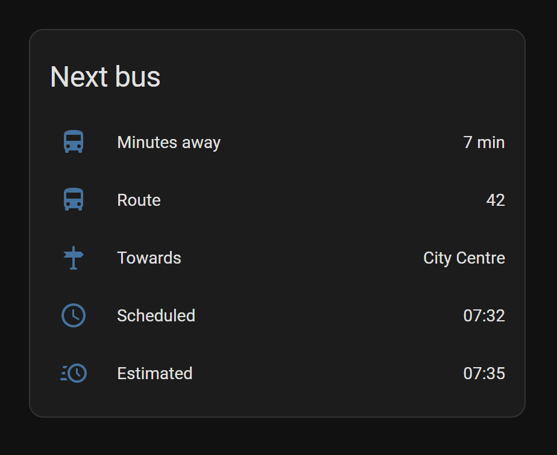
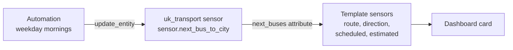

# UK Bus Timetable for Home Assistant

Show the next bus from your local stop in Home Assistant: route, direction, scheduled time, live estimated time and minutes until it arrives.

It uses Home Assistant's built-in **UK Transport** integration (`uk_transport`) with live data from [TransportAPI](https://developer.transportapi.com). There is nothing to install from HACS.

 

## Contents

- [What you get](#what-you-get)
- [How it works](#how-it-works)
- [Files](#files)
- [Setup](#setup)
  - [1. Get a TransportAPI key](#1-get-a-transportapi-key)
  - [2. Find your stop's ATCO code](#2-find-your-stops-atco-code)
  - [3. Add your secrets](#3-add-your-secrets)
  - [4. Add the sensors](#4-add-the-sensors)
  - [5. Add the refresh automation](#5-add-the-refresh-automation)
  - [6. Add a dashboard card](#6-add-a-dashboard-card)
- [Troubleshooting](#troubleshooting)

 

## What you get

  

The dashboard card from step 6, shown with sample data.

| Entity | Example state | What it is |
|---|---|---|
| `sensor.next_bus_to_city` | `7` | Minutes until the next bus. Holds the full list of upcoming buses in its `next_buses` attribute |
| `sensor.next_bus_route` | `42` | Route number |
| `sensor.next_bus_direction` | `City Centre` | Where the bus is heading |
| `sensor.next_bus_scheduled` | `07:32` | Timetabled departure |
| `sensor.next_bus_estimated` | `07:35` | Live estimated departure |

 

## How it works

The `uk_transport` sensor calls TransportAPI. The automation decides **when** it refreshes, which keeps you inside the API's daily limit. The template sensors update automatically whenever the main sensor changes.

 

## Files

| File | Where it goes |
|---|---|
| [`yaml/configuration.yaml`](yaml/configuration.yaml) | Your `configuration.yaml` |
| [`yaml/secrets.yaml.example`](yaml/secrets.yaml.example) | Your `secrets.yaml` |
| [`yaml/automation.yaml`](yaml/automation.yaml) | A new automation, via **Edit in YAML** |
| [`yaml/dashboard_card.yaml`](yaml/dashboard_card.yaml) | A new **Manual** dashboard card |

 

## Setup

### 1. Get a TransportAPI key

1. Sign up at [developer.transportapi.com](https://developer.transportapi.com). The free plan is fine.
2. Create an app and note its **App ID** and **App Key**.

> [!IMPORTANT]
> Check your plan's daily request limit. The free plan is small, so this setup only refreshes at set times rather than polling all day.

 

### 2. Find your stop's ATCO code

1. Search for your stop on [bustimes.org](https://bustimes.org).
2. Open the stop page. The ATCO code is the end of the URL, for example `bustimes.org/stops/1234AB56` gives `1234AB56`.

> [!TIP]
> Most roads have a stop on each side. Pick the one for the direction you want to travel.

 

### 3. Add your secrets

Add the two lines from [`secrets.yaml.example`](yaml/secrets.yaml.example) to your Home Assistant `secrets.yaml`, using your own App ID and Key.

 

### 4. Add the sensors

1. Copy [`yaml/configuration.yaml`](yaml/configuration.yaml) into your `configuration.yaml`.
2. Replace `YOUR_ATCO_CODE` with your stop's code.
3. Set `destination` to a word that appears in the destination shown on the bus, for example `City`.
4. In Home Assistant, open the **YAML** tab in **Tools** (called **Developer Tools** on older versions), click **Check configuration**, then **restart**.

> [!NOTE]
> If you already have a `sensor:` or `template:` section, add these entries under it. Don't repeat the key.

> [!WARNING]
> The main sensor is named after the destination. `destination: City` gives `sensor.next_bus_to_city`. If you change the destination, update `sensor.next_bus_to_city` in the template sensors, the automation and the card to match.

 

### 5. Add the refresh automation

1. Go to **Settings > Automations & scenes > Create automation**.
2. Open the **⋮** menu, choose **Edit in YAML** and paste [`yaml/automation.yaml`](yaml/automation.yaml).
3. Save.

By default this refreshes every 10 minutes from 07:00 to 08:30 on weekdays, which is 9 API calls a day. Change the times, days and interval to suit your journey and your API limit.

 

### 6. Add a dashboard card

Edit a dashboard, choose **Add card > Manual** and paste [`yaml/dashboard_card.yaml`](yaml/dashboard_card.yaml).

 

## Troubleshooting

| Problem | Fix |
|---|---|
| Everything shows `none` | No buses matched. Check the ATCO code, and that `destination` appears in the bus direction text |
| Old times showing | Expected outside the automation's hours. The data is only as fresh as the last refresh |
| `sensor.next_bus_to_city` missing | Check **Settings > System > Logs** for `uk_transport` errors, usually a wrong App ID or Key |
| Want the bus after next | Change `b[0]` to `b[1]` in a template sensor |

> [!TIP]
> To track a second stop or destination, add another entry under `queries:`. Each one creates its own `sensor.next_bus_to_<destination>`.
